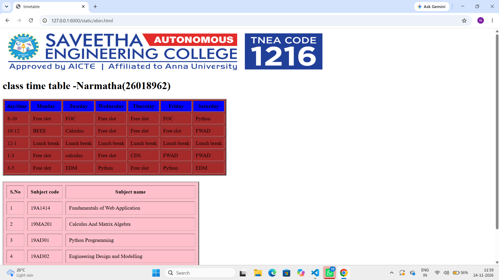

# Ex04 Time Table
## Date:21-11-26

## AIM
To write a html webpage page to display your slot timetable.

## ALGORITHM
### STEP 1
Create a Django-admin Interface.

### STEP 2
Create an App inside the Django project.

### STEP 2
Create a static folder uder the created App and insert HTML code.

### STEP 3
Create a simple table using ```<table>``` tag in html with the relevant attributes.

### STEP 4
Add rows using ```<tr>``` tag.

### STEP 5
Add your course schedule using ```<td>``` tag.

### STEP 6
Execute the program using runserver command.

## PROGRAM
```
<html>
    <head>
        <title>timetable</title>
    </head>
    <body>
<centre>
        
        <table border="3" bgcolor="brown" cellpadding="7" cellspacing="4">
        <h1>class time table -Narmatha(26018962)</h1>
    <tr bgcolor="blue">
        <th>day/time</th>
        <th>Monday</th>
        <th>Tuseday</th>
        <th>Wednesday</th>
        <th>Thursday</th>
        <th>Friday</th>
        <th>Saturday</th>
    </tr>
    <tr>
        <td>8-10</td>
        <td>Free slot</td>
        <td>FOC</td>
        <td>Free slot</td>
        <td>Free slot</td>
        <td>FOC</td>
        <td>Python</td>
    </tr>
    <tr>
        <td>10-12</td>
        <td>BEEE</td>
        <td>Calculus</td>
        <td>Free slot</td>
        <td>Free slot</td>
        <td>Free slot</td>
        <td>FWAD</td>
    </tr>
    <tr>
        <td>12-1</td>
        <td>Lunch break</td>
        <td>Lunch break</td>
        <td>Lunch break</td>
        <td>Lunch break</td>
        <td>Lunch break</td>
        <td>Lunch break</td>
    </tr>
    <tr>
        <td>1-3</td>
        <td>Free slot</td>
        <td>calculus</td>
        <td>Free slot</td>
        <td>CDS</td>
        <td>FWAD</td>
        <td>FWAD</td>
    </tr>
    <tr>
        <td>3-5</td>
        <td>Free slot</td>
        <td>EDM</td>
        <td>Python</td>
        <td>Free slot</td>
        <td>Python</td>
        <td>EDM</td>
    </tr>
        </table>
    <br>
<table border="3" bgcolor="pink" cellspacing="10" cellpadding="10">
    <tr>
        <th>S.No</th>
        <th>Subject code</th>
        <th>Subject name</th>
    </tr>
    <tr>
        <td>1</td>
        <td>19A1414</td>
        <td>Fundamentals of Web Application</td>
    </tr>
    <tr>
        <td>2</td>
        <td>19MA201</td>
        <td>Calculus And Matrix Algebra</td>
    </tr>
    <tr>
        <td>3</td>
        <td>19AI301</td>
        <td>Python Programming</td>
    </tr>
    <tr>
        <td>4</td>
        <td>19AI302</td>
        <td>Engineering Design and Modelling</td>
    </tr>
    <tr>
        <td>5</td>
        <td>19CS547</td>
        <td>Fundamental Of Cryptocurrency</td>
    </tr>
    <tr>
        <td>6</td>
        <td>19EE305</td>
        <td>Basic Electrical Electronics and Measurement Engineering</td>
    </tr>
</table>
        </centre>
</body>
</html>
```

## OUTPUT


## RESULT
The program for creating slot timetable using basic HTML tags is executed successfully.
